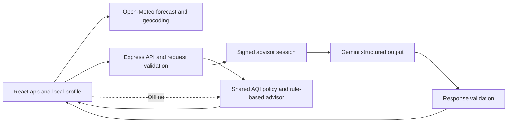

# Aura · Urban Air Quality Assistant

Aura helps families plan school runs, commutes, and time outdoors during urban smog. It combines a live location forecast with advice that responds to a household’s needs, its available equipment, and the question being asked.

## Challenge vertical

**Urban air quality assistant.** The primary persona is a caregiver in a city affected by winter smog. The caregiver needs to decide whether to reschedule an outdoor activity, how to make one room easier to keep clean, and what to change on the next commute. The same workflow supports older adults, commuters, apartment residents, and households with limited budgets.

## Try the deployed app

Open [Aura on Vercel](https://aura-air-quality-assistant.vercel.app). Loading the app sends a background health request to wake the Render API while the air-quality interface loads. Public visitors can try location search, routines, and personalized rule-based advice immediately. The hosted Gemini mode requires the advisor access code.

## Run Aura locally

Use Node.js 24 LTS and npm. The default launch needs no accounts or API keys.

```bash
npm ci
npm --prefix frontend ci
npm --prefix server ci
npm run dev
```

Open [http://localhost:3000](http://localhost:3000). Vite forwards API requests to Express on port 3001. Pick a city or search for a locality, open **Routines** to compare hours, then open **AI Advisor** and compare the results for **My household** and **Budget-Conscious Household**.

For a single same-origin server that serves the built app, including direct links such as `/routines`, run:

```bash
npm run build
npm start
```

Open [http://localhost:3001](http://localhost:3001).

### Enable live Gemini responses

Copy `.env.example` to `.env`. Set `GEMINI_API_KEY` to your server-side key, and set `AURA_ADVISOR_ACCESS_CODE` to a random 24–256 character code. For example, generate one with `openssl rand -hex 24`. The default model is `gemini-3.8-flash`. Set `GEMINI_MODEL` to a compatible structured-output model available to your account. Restart the app, open **AI Advisor**, and unlock Gemini with the access code. Deploy over HTTPS for the production session cookie.

Anonymous visitors get personalized rule-based guidance. An authenticated browser can access Gemini for 12 hours or sign out earlier. Each answer labels its mode. A short provider deadline, one schema-repair attempt for malformed results, a concurrency limit, and a cooldown protect the service when the provider is slow or unavailable.

### Verify trusted proxy hops

Set `AURA_TRUST_PROXY` to the numeric count of trusted proxies in front of Express after checking the deployed forwarding chain. To log the chain once, request `/api/health?proxyProbe=1` through Vercel and inspect the Render logs for `health_proxy_probe`. The log entry contains `req.ip`, `req.ips`, and `X-Forwarded-For`. For a visitor-specific check, request this URL from the phone over mobile data before setting the final hop count. See Vercel's [request-header documentation](https://vercel.com/docs/headers/request-headers) and Render's [client-IP and rate-limiting guidance](https://render.com/articles/how-render-handles-ddos-attacks).

## Decision logic

| Input | Result |
| --- | --- |
| Location and current US AQI | Search uses Open-Meteo geocoding. The app displays the returned US AQI band and pollutant values separately and adapts outdoor activity guidance for the household. |
| Hourly forecast | The timeline shows available hours in the location’s time zone. Aura compares adjacent hourly estimates and surfaces the lowest-average two-hour period where both hours are below the current AQI. The identified period includes its peak AQI, so a relative improvement retains the relevant precautions. |
| Household and question | Household size, sensitivity, commute, room setup, equipment, and budget guide the next actions. The rule-based advisor prioritizes the current question or its recent context. For example, a household without a filter gets source-control steps for an indoor question. |
| Poor air quality in the community | The community page prioritizes checking in on neighbors based on current AQI and household sensitivity, and can open a prefilled advisor prompt for planning next steps. |
| Data or model service unavailable | A saved US AQI estimate is labeled with its age and its hourly forecast is hidden. With no usable cache, the interface shows an unavailable reading. The advisor continues with local rules during a model or API outage. |
| Recognized emergency symptoms | Local rules immediately surface emergency guidance in English, Hindi, or Punjabi. The Gemini provider is bypassed. |



- `frontend/` contains routes, location and forecast handling, browser storage, and browser tests.
- `server/` contains the HTTP API, access-code session, provider integration, schemas, and API tests.
- `shared/` contains AQI bands, activity guidance, and the offline advisor used by both runtimes.

## Assumptions and privacy

- Open-Meteo and CAMS provide model estimates. Street-level conditions can differ. For time-sensitive plans, check official local alerts and follow any clinician-provided care plan.
- Selecting browser location rounds coordinates to about one kilometer before requesting Open-Meteo data. Coordinates are excluded from advisor questions. Household settings, saved readings, and the action ledger use browser storage. Chat is kept in memory while the advisor is open.
- An advisor request includes the selected household fields, recent chat turns, and air context. The Gemini adapter excludes coordinates and masks common email and phone formats. Avoid entering identifying details. The access code authorizes this deployment’s paid advisor and does not create a personal account. Rotating the code invalidates outstanding sessions.
- The separate Sanctuary page contains the air-quality illustration and loads Three.js on demand for the interactive view. Filter effects in the scene are illustrative. Indoor PM2.5 requires a user-entered monitor reading.
- The ledger counts the actions users record. Effects are qualitative. Hindi and Punjabi navigation are available, and Gemini can answer in the selected language. Offline recommendation details are currently in English.

## Validation

```bash
npm run lint
npm test
npm run check:contrast
npm run build
npm --prefix frontend exec -- playwright install chromium
npm run test:e2e
```

Tests cover AQI boundaries, missing forecast points, optional weather failures, location search, household selection, conversational context, cache behavior, browser accessibility, protected advisor access, provider retry and cooldown, and urgent guidance. Playwright runs at mobile and desktop widths with deterministic air-feed fixtures, real browser storage, and the local API. It checks keyboard focus, both share-card sizes, language selection, and axe WCAG 2.0 and 2.1 A/AA rules. The GitHub workflow runs those checks and audits all lockfiles.

## Data and guidance sources

- Air-quality estimates and forecasts from [Open-Meteo](https://open-meteo.com/en/docs/air-quality-api) and [Copernicus Atmosphere Monitoring Service and CAMS ENSEMBLE](https://atmosphere.copernicus.eu/).
- US AQI categories and outdoor activity guidance from [AirNow AQI Basics](https://www.airnow.gov/aqi/aqi-basics/) and the [AirNow particle pollution guide](https://document.airnow.gov/air-quality-guide-for-particle-pollution.pdf).
- Indoor guidance from the [EPA guide to air cleaners](https://www.epa.gov/indoor-air-quality-iaq/guide-air-cleaners-home) and [EPA research on DIY air cleaners](https://www.epa.gov/air-research/research-diy-air-cleaners-reduce-wildfire-smoke-indoors).
- Community respirator guidance from [CDC / NIOSH](https://www.cdc.gov/niosh/ppe/php/community-respirators-masks/).
