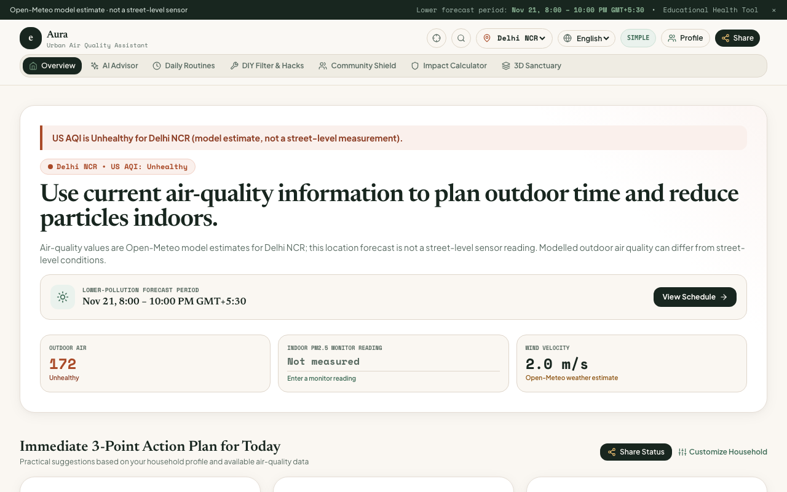
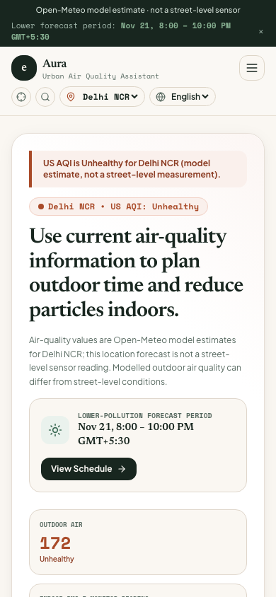
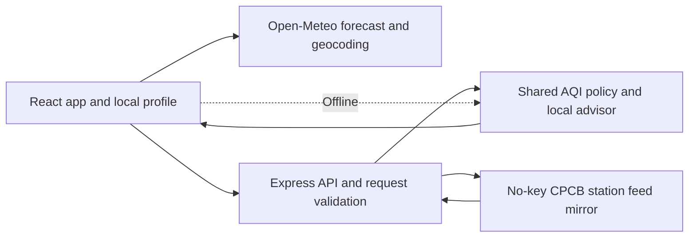

# Aura · Urban Air Quality Assistant

Aura helps families plan school runs, commutes, and time outdoors during urban smog. It combines a live location forecast with advice that responds to a household’s needs, its available equipment, and the question being asked.

## Screenshots

Desktop and mobile overview with example forecast data from the browser test fixtures.





## Challenge vertical

**Urban air quality assistant.** The primary persona is a caregiver in a city affected by winter smog. The caregiver needs to decide whether to reschedule an outdoor activity, how to make one room easier to keep clean, and what to change on the next commute. The same workflow supports older adults, commuters, apartment residents, and households with limited budgets.

## Try the deployed app

Open [Aura on Vercel](https://aura-air-quality-assistant.vercel.app). Loading the app sends a background health request to wake the Render API while the air-quality interface loads. Location search, routines, and personalized local rule-based advice are available without API keys or an account.

## Run Aura locally

Use Node.js 24 LTS and npm. Aura does not use a Gemini key or any other API key. It calls public Open-Meteo services without credentials for forecasts and geocoding, and uses local deterministic rules for advice.

```bash
npm ci
npm --prefix frontend ci
npm --prefix server ci
npm run dev
```

Open [http://localhost:3000](http://localhost:3000). Vite forwards API requests to Express on port 3001. Pick a city or search for a locality, open **Routines** to compare hours, then open **Advisor** and compare the results for **My household** and **Budget-Conscious Household**.

The overview also shows the nearest CPCB PM2.5 and PM10 station within 25 km for locations in India. It uses a public [CPCB dataset on data.gov.in](https://www.data.gov.in/resource/real-time-air-quality-index-various-locations), served by the third-party [Snapdata mirror](https://snapdata.dev/docs/datasets/aqi/). Snapdata describes its `avg` field as a reported pollutant concentration and documents a three-hour refresh cadence, but does not specify the averaging period. Aura labels it a reported average and shows the station timestamp without calling it an hourly or 24-hour average. Readings older than six hours and null readings are excluded, and a farther reporting station is selected when the nearer one has no current values. If the mirror is unavailable, the card says the source is unavailable. These station concentrations stay separate from Open-Meteo's model estimate.

For a single same-origin server that serves the built app, including direct links such as `/routines`, run:

```bash
npm run build
npm start
```

Open [http://localhost:3001](http://localhost:3001).

### Keyless advice and configuration

Advice is generated locally from the selected household profile, question, and available air-quality context. Urgent symptom guidance is also local and bypasses the network. The app returns the completed rule-based advice as JSON; no hosted language model is called. Detailed recommendations are currently in English, while urgent safety summaries are translated. Copy `.env.example` only if you need to change the port, allowed origins, or trusted-proxy setting.

### Deploy behind a reverse proxy

The Render deployment sets `AURA_TRUST_PROXY=4`, based on the forwarded-IP chain observed through Vercel and Render. Set this variable to the numeric number of trusted hops for your deployment path; a missing value disables proxy trust. Recheck the setting if the proxy route changes. See Vercel's [request-header documentation](https://vercel.com/docs/headers/request-headers) and Render's [notes on client IPs and rate limiting](https://render.com/articles/how-render-handles-ddos-attacks).

## Decision logic

| Input | Result |
| --- | --- |
| Location and current US AQI | Search uses Open-Meteo geocoding. The app displays the returned US AQI band and pollutant values separately and adapts outdoor activity guidance for the household. |
| Hourly forecast | The timeline shows available hours in the location’s time zone. Aura compares adjacent hourly estimates and surfaces the lowest-average two-hour period where both hours are below the current AQI. The identified period includes its peak AQI, so a relative improvement retains the relevant precautions. |
| Household and question | Household size, sensitivity, commute, room setup, equipment, and budget guide the next actions. The local rule-based advisor prioritizes the current question or its recent context. For example, a household without a filter gets source-control steps for an indoor question. |
| Nearby station observations | For locations in India, the closest CPCB station within 25 km can show raw PM2.5 and PM10 values with observation times. These measurements are not an AQI or a reading at the selected location. |
| Poor air quality in the community | The community page prioritizes checking in on neighbors based on current AQI and household sensitivity, and can open a prefilled advisor prompt for planning next steps. |
| Data service unavailable | A saved US AQI estimate is labeled with its age and its hourly forecast is hidden. With no usable cache, the interface shows an unavailable reading. Advice continues with local rules during a feed outage. |
| Recognized emergency symptoms | Local rules immediately surface emergency guidance in English, Hindi, or Punjabi. No external model is called. |



- `frontend/` contains routes, location and forecast handling, browser storage, and browser tests.
- `server/` contains the HTTP API, local streaming, station-feed integration, schemas, and API tests.
- `shared/` contains AQI bands, activity guidance, and the offline advisor used by both runtimes.

## Assumptions and privacy

- Open-Meteo and CAMS provide model estimates. Street-level conditions can differ. CPCB station readings come from government data mirrored by Snapdata and may lag the source. For time-sensitive plans, check official local alerts and follow any clinician-provided care plan.
- Selecting browser location rounds coordinates to about one kilometer before requesting Open-Meteo data. The station lookup sends coordinates rounded to two decimal places to Aura's own server; the server downloads the India feed and selects the nearest station without sending those coordinates to the feed mirror. Station coordinates are not returned to the browser. Coordinates are excluded from advisor requests. Household settings, saved readings, and the action ledger use browser storage. Chat is kept in memory while the advisor is open.
- Advice requests include selected household fields, recent chat turns, air context, and an available nearby station reading. Aura does not send them to a hosted language model. Avoid entering identifying details.
- The separate Sanctuary page contains the air-quality illustration and loads Three.js on demand for the interactive view. Filter effects in the scene are illustrative. Indoor PM2.5 requires a user-entered monitor reading.
- The ledger counts the actions users record. Effects are qualitative. Hindi and Punjabi navigation and urgent safety summaries are available; detailed rule-based recommendations are currently in English.

## Validation

```bash
npm run lint
npm test
npm run check:contrast
npm run build
npm --prefix frontend exec -- playwright install chromium
npm run test:e2e
```

Tests cover AQI boundaries, missing forecast points, optional weather failures, location search, household selection, conversational context, cache behavior, local advice, CPCB station selection, streamed responses, browser accessibility, and urgent guidance. Playwright runs at mobile and desktop widths with deterministic air-feed fixtures, real browser storage, and the local API. It checks keyboard focus, both share-card sizes, language selection, and axe WCAG 2.0 and 2.1 A/AA rules. The GitHub workflow runs those checks and audits all lockfiles.

## Data and guidance sources

- Air-quality estimates and forecasts from [Open-Meteo](https://open-meteo.com/en/docs/air-quality-api) and [Copernicus Atmosphere Monitoring Service and CAMS ENSEMBLE](https://atmosphere.copernicus.eu/).
- CPCB ground-monitor measurements published through [data.gov.in](https://www.data.gov.in/resource/real-time-air-quality-index-various-locations) and mirrored by [Snapdata](https://snapdata.dev/docs/datasets/aqi/) under India's Government Open Data License.
- US AQI categories and outdoor activity guidance from [AirNow AQI Basics](https://www.airnow.gov/aqi/aqi-basics/) and the [AirNow particle pollution guide](https://document.airnow.gov/air-quality-guide-for-particle-pollution.pdf).
- Indoor guidance from the [EPA guide to air cleaners](https://www.epa.gov/indoor-air-quality-iaq/guide-air-cleaners-home) and [EPA research on DIY air cleaners](https://www.epa.gov/air-research/research-diy-air-cleaners-reduce-wildfire-smoke-indoors).
- Community respirator guidance from [CDC / NIOSH](https://www.cdc.gov/niosh/ppe/php/community-respirators-masks/).
