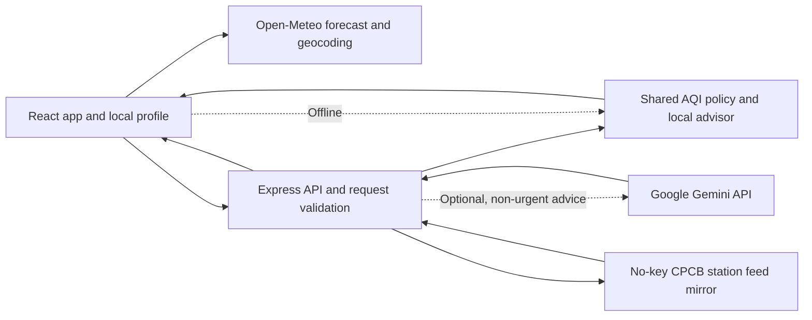

# Aura · Urban Air Quality Assistant

Aura helps families plan school runs, commutes, and time outdoors during urban smog. It combines a live location forecast with advice that responds to a household’s needs, its available equipment, and the question being asked.

## Screenshots

Desktop and mobile overview with example forecast data from the browser test fixtures.


## Challenge vertical

**Urban air quality assistant.** The primary persona is a caregiver in a city affected by winter smog. The caregiver needs to decide whether to reschedule an outdoor activity, how to make one room easier to keep clean, and what to change on the next commute. The same workflow supports older adults, commuters, apartment residents, and households with limited budgets.

## Try the deployed app

Open [Aura on Vercel](https://aura-air-quality-assistant.vercel.app). Loading the app sends a background health request to wake the Render API while the air-quality interface loads. Location search, routines, and personalized local rule-based advice are available without API keys or an account.

## Run Aura locally

Use Node.js 24 LTS and npm. Aura works without API keys by default: it calls public Open-Meteo services without credentials for forecasts and geocoding, and uses local deterministic rules for advice. An optional server-side Gemini advisor can be enabled with a new `GEMINI_API_KEY`.

```bash
npm ci
npm --prefix frontend ci
npm --prefix server ci
npm run dev
```

Open [http://localhost:3000](http://localhost:3000). Vite forwards API requests to Express on port 3001. Pick a city or search for a locality, open **Routines** to compare hours, then open **Advisor** and compare the results for **My household** and **Budget-Conscious Household**.

The overview also shows the nearest CPCB PM2.5 and PM10 station within 25 km for locations in India. It uses a public [CPCB dataset on data.gov.in](https://www.data.gov.in/resource/real-time-air-quality-index-various-locations), served by the third-party [Snapdata mirror](https://snapdata.dev/docs/datasets/aqi/). Snapdata describes its `avg` field as a reported pollutant concentration and documents a three-hour refresh cadence, but does not specify the averaging period. Aura labels it a reported average and shows the station timestamp without calling it an hourly or 24-hour average. Readings older than six hours and null readings are excluded, and a farther reporting station is selected when the nearer one has no current values. If the mirror is unavailable, the card says the source is unavailable. These station concentrations stay separate from Open-Meteo's model estimate.

For a single same-origin server that serves the built app, including direct links such as `/routines`, run:

```bash
npm run build
npm start
```

Open [http://localhost:3001](http://localhost:3001).

### Keyless advice and optional Gemini mode

Without `GEMINI_API_KEY`, advice is generated locally from the selected household profile, question, and available air-quality context. Urgent symptom guidance always stays local and bypasses the model. English, Hindi, and Punjabi rule-based recommendations are available offline. The Hindi and Punjabi copy still needs native-speaker review. If a key is configured on the server, non-urgent advice uses the Google GenAI SDK with `GEMINI_MODEL` (default `gemini-3.8-flash`); the response is validated against Aura's advice schema. Gemini is asked to answer in the selected language and to keep impact descriptions qualitative. If Gemini is unavailable, returns invalid advice, or reaches its daily call cap, Aura falls back to local rules. At startup, Aura makes one bounded model-metadata request to check the configured model and credentials; `/api/health` reports whether the provider check is ready or unavailable. This does not generate advice content. The key is never sent to the browser. Use a newly created key; do not reuse a revoked credential. Add `GEMINI_API_KEY` and, optionally, `GEMINI_MODEL` to the server's environment to enable the mode. Leave them unset for keyless local advice. See Google's [supported Gemini models](https://ai.google.dev/gemini-api/docs/models) for current model IDs.

`AURA_GEMINI_DAILY_LIMIT` defaults to 10 attempted Gemini API calls per UTC day across all clients handled by one server process. The startup metadata check uses one call from this allowance. Requests rejected locally as `ADVISOR_BUSY` do not consume the cap. Failed calls do consume it because a provider request may already have been sent. The counter resets at UTC midnight and when the process restarts; if you run multiple Render instances, each instance has its own counter. Use one instance for this in-process cap or move the counter to a shared store before scaling horizontally. Google Cloud budget alerts are useful for monitoring, but alerts alone do not stop charges.

### Deploy behind a reverse proxy

Vercel sends `/api/*` requests through a serverless proxy that forwards Vercel's client IP and adds a shared secret. The proxy implementation lives outside the `api/` directory so Vercel exposes only the intended catch-all API function. Set the same randomly generated `AURA_EDGE_TOKEN` in Vercel and Render; Render rejects API calls without it, including direct requests to the public `onrender.com` URL. Set `AURA_TRUST_PROXY` on Render to the number of trusted proxy hops in front of Express. The health endpoint reports the observed `X-Forwarded-For` chain length, logs the first value seen, and warns if that length changes while the process is running. Check the value in deployment logs after changing the Vercel-to-Render route. Vercel overwrites incoming `X-Forwarded-For` with the observed client IP, which prevents callers from choosing their own rate-limit key. Configure a Google Cloud budget or spend-cap budget for the Gemini API project as a separate billing safeguard. See [Vercel request headers](https://vercel.com/docs/headers/request-headers), [Render's rate-limit notes](https://render.com/articles/how-render-handles-ddos-attacks), [Google Cloud budget alerts](https://cloud.google.com/billing/docs/how-to/budgets), and [spend-cap budgets](https://cloud.google.com/billing/docs/how-to/budgets-spend-caps).

## Decision logic

| Input | Result |
| --- | --- |
| Location and current US AQI | Search uses Open-Meteo geocoding. The app displays the returned US AQI band and pollutant values separately and adapts outdoor activity guidance for the household. |
| Hourly forecast | The timeline shows available hours in the location’s time zone. Aura compares adjacent hourly estimates and surfaces the lowest-average two-hour period where both hours are below the current AQI. The overview also summarizes whether the next available forecast points trend lower, higher, or stay similar and prompts a recheck before outdoor plans. The identified lower period includes its peak AQI, so a relative improvement retains the relevant precautions. |
| Household and question | Household size, sensitivity, commute, room setup, equipment, and budget guide the next actions. The local rule-based advisor prioritizes the current question or its recent context. For example, a household without a filter gets source-control steps for an indoor question. |
| Nearby station observations | For locations in India, the closest CPCB station within 25 km can show raw PM2.5 and PM10 values with observation times. These measurements are not an AQI or a reading at the selected location. |
| Freshness | Live model readings show the provider reading time. Cached values show their saved time and age; CPCB observations show the station-reported time. |
| Sharing | The share dialog offers a plain-text summary that can be copied or shared through the device’s available apps, as well as a share-card image. |
| Poor air quality in the community | The community page prioritizes checking in on neighbors based on current AQI and household sensitivity, and can open a prefilled advisor prompt for planning next steps. |
| Data service unavailable | A saved US AQI estimate is labeled with its age and its hourly forecast is hidden. With no usable cache, the interface shows an unavailable reading. Advice continues with local rules during a feed outage. |
| Recognized emergency symptoms | Local rules immediately surface emergency guidance in English, Hindi, or Punjabi. No external model is called. |



- `frontend/` contains routes, location and forecast handling, browser storage, and browser tests.
- `server/` contains the HTTP API, local advice, optional Gemini integration, station-feed integration, schemas, and API tests.
- `shared/` contains AQI bands, activity guidance, and the offline advisor used by both runtimes.

## Assumptions and privacy

- Open-Meteo and CAMS provide model estimates. Street-level conditions can differ. CPCB station readings come from government data mirrored by Snapdata and may lag the source. For time-sensitive plans, check official local alerts and follow any clinician-provided care plan.
- Selecting browser location rounds coordinates to about one kilometer before requesting Open-Meteo data. The station lookup sends coordinates rounded to two decimal places to Aura's own server; the server downloads the India feed and selects the nearest station without sending those coordinates to the feed mirror. Station coordinates are not returned to the browser. Coordinates are excluded from advisor requests. Household settings, saved readings, and the action ledger use browser storage. Chat is kept in memory while the advisor is open.
- Advice requests include selected household fields, recent chat turns, air context, and an available nearby station reading. They are sent to Google only when the optional Gemini mode is enabled; coordinates are not included. Avoid entering identifying details. Urgent symptom requests stay local.
- The separate Sanctuary page contains the air-quality illustration and loads Three.js on demand for the interactive view. Filter effects in the scene are illustrative. Indoor PM2.5 requires a user-entered monitor reading.
- The ledger counts the actions users record. Effects are qualitative. Hindi and Punjabi navigation, urgent safety guidance, and rule-based recommendations are available. Hindi and Punjabi advisor wording still needs native-speaker review.

## Validation

```bash
npm run lint
npm run typecheck
npm test
npm run check:contrast
npm run build
npm --prefix frontend exec -- playwright install chromium
npm run test:e2e
```

Tests cover AQI boundaries, missing forecast points, optional weather failures, location search, household selection, conversational context, cache behavior, local advice, direct shared-advice and station-service rules, forecast-trend summaries, browser accessibility, and multilingual urgent guidance. Vitest enforces minimum coverage thresholds for shared advice and station-feed logic in CI. `npm run typecheck` checks the JSDoc-typed `shared/` and `server/` JavaScript modules. Playwright runs at mobile and desktop widths with deterministic air-feed fixtures, real browser storage, and the local API. It checks keyboard focus, both share-card sizes, language selection, and axe WCAG 2.0 and 2.1 A/AA rules. The GitHub workflow audits all lockfiles.

## Data and guidance sources

- Air-quality estimates and forecasts from [Open-Meteo](https://open-meteo.com/en/docs/air-quality-api) and [Copernicus Atmosphere Monitoring Service and CAMS ENSEMBLE](https://atmosphere.copernicus.eu/).
- CPCB ground-monitor measurements published through [data.gov.in](https://www.data.gov.in/resource/real-time-air-quality-index-various-locations) and mirrored by [Snapdata](https://snapdata.dev/docs/datasets/aqi/) under India's Government Open Data License.
- US AQI categories and outdoor activity guidance from [AirNow AQI Basics](https://www.airnow.gov/aqi/aqi-basics/) and the [AirNow particle pollution guide](https://document.airnow.gov/air-quality-guide-for-particle-pollution.pdf).
- Indoor guidance from the [EPA guide to air cleaners](https://www.epa.gov/indoor-air-quality-iaq/guide-air-cleaners-home) and [EPA research on DIY air cleaners](https://www.epa.gov/air-research/research-diy-air-cleaners-reduce-wildfire-smoke-indoors).
- Community respirator guidance from [CDC / NIOSH](https://www.cdc.gov/niosh/ppe/php/community-respirators-masks/).
